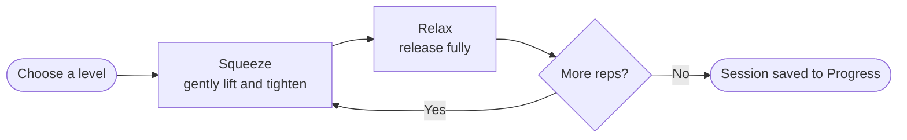

<div align="center">

# Kegely for Men

### A simple, private pelvic floor trainer.

Guided Kegel sessions, supporting exercises, progress tracking and practical technique advice. Free, mobile-friendly, and no account required.

[](https://flikx-labs.github.io/Kegely/)


[Features](#features) · [Quick start](#quick-start) · [How it works](#how-it-works) · [Install](#install-on-your-phone) · [Privacy](#privacy) · [FAQ](#faq)

</div>

---

<p align="center">
  
  
  
  
  
</p>

<p align="center"><sub>Timer &nbsp;·&nbsp; Exercises &nbsp;·&nbsp; Progress &nbsp;·&nbsp; Guide &nbsp;·&nbsp; Reminders</sub></p>

## Why Kegely?

Pelvic floor training is simple in theory and surprisingly hard to keep up in practice. Kegely takes care of the parts that make it hard:

- **Pacing.** A breathing orb, countdown and progress ring tell you exactly when to squeeze and when to let go.
- **Consistency.** Streaks, weekly activity and reminders help the habit stick.
- **Technique.** A built-in guide covers finding the right muscles and avoiding common mistakes.
- **Privacy.** There is no sign-up, no backend and no analytics. Your data never leaves your device.

## Features

| | Feature | What you get |
|---|---|---|
| ⏱️ | **Guided training timer** | A visual breathing orb, countdown and progress ring for every squeeze and relax phase |
| 🎚️ | **Flexible levels** | Beginner, Intermediate, Advanced, or a Custom routine with your own timings and repetitions |
| 🔔 | **Multiple cues** | Turn sound, voice guidance and vibration on or off independently |
| 🗣️ | **Voice guidance** | Choose between **Nora** and **Maya**, using the speech voices available on your device |
| 🧘 | **Supporting exercises** | Ten gentle movements, including squats, glute bridges, bird dogs and child's pose |
| 📈 | **Progress tracking** | Completed sessions, daily streak, weekly activity, time trained, a 7-day chart and a 5-week activity grid |
| ⏰ | **Daily reminders** | Add multiple reminder times and manage each one individually |
| 📖 | **Practical guide** | Find the right muscles, avoid common mistakes and build up gradually |
| 💾 | **Backup & restore** | Export your progress to a JSON file and import it after clearing browser data or on another device |
| 📱 | **Installable PWA** | Add it to your home screen for an app-like, offline-friendly experience |
| 🎨 | **12 themes** | Auto (follows your device), Light, Dark, plus Midnight, Ocean, Forest, Sunset, Lavender, Sand, Sky, Mint and Rose, chosen on the Guide screen |

> [!NOTE]
> The supporting exercises complement pelvic floor training. They are not Kegels themselves.

## Quick start

1. Open **https://flikx-labs.github.io/Kegely/** in your browser.
2. Pick a training level (or build a custom routine).
3. Press start and follow the orb.

That's it. No account, no download, no setup.

## How it works



1. **Choose a training level** or configure your own timings.
2. During **Squeeze**, gently lift and tighten your pelvic floor while breathing normally.
3. During **Relax**, release fully before the next repetition.
4. Complete the slow holds and quick squeezes at a comfortable pace.
5. Use the **Exercises** and **Guide** sections for supporting movements and technique advice.
6. Check **Progress** to follow your consistency over time.

### Technique at a glance

| ✅ Do | ❌ Don't |
|---|---|
| Keep your stomach, thighs and buttocks relaxed | Clench your stomach, thighs or buttocks |
| Breathe normally throughout | Hold your breath |
| Squeeze gently and lift | Squeeze as hard as possible |
| Release fully between repetitions | Rush into the next rep without relaxing |
| Build up gradually | Push through pain |

## Install on your phone

Kegely is a Progressive Web App, so it can live on your home screen like a native app.

| Device | Steps |
|---|---|
| **iPhone / iPad** | Open the site in **Safari**, tap **Share**, then choose **Add to Home Screen** |
| **Android** | Open the site in **Chrome**, then choose **Install app** from the browser menu or the install prompt |

> [!TIP]
> For the best experience, open Kegely in your device's main browser rather than an in-app browser.

## Privacy

Kegely is designed to work without an account or a backend.

| Data | Where it lives |
|---|---|
| Training history | Locally in your browser, on your device |
| Preferences | Locally in your browser, on your device |
| Reminders | Locally in your browser, on your device |
| Accounts | None. There is no sign-up |
| Analytics | None. There is no tracking |

The app may ask for **notification permission** when you enable reminders. Voice guidance uses your browser's built-in speech synthesis.

## Reminders: an important note

> [!IMPORTANT]
> Browser notifications can appear while Kegely is open or running in the background. Mobile operating systems may pause a fully closed browser app, so browser notifications are **not guaranteed** to fire at an exact time in that situation.

For reliable scheduled alerts, use **Add to calendar** on the reminders screen. It adds repeating daily events to your phone's calendar.

## FAQ

<details>
<summary><b>Do I need to create an account?</b></summary>

No. Open the link and start training. Nothing to sign up for.
</details>

<details>
<summary><b>Where is my progress stored?</b></summary>

Locally in your browser on your device. Because of that, clearing your browser data will also clear your history, and progress does not sync between devices. Use **Progress → Export backup** to save a file and **Import backup** to restore it.
</details>

<details>
<summary><b>Does it work offline?</b></summary>

Once installed as a PWA, Kegely offers an offline app experience.
</details>

<details>
<summary><b>Why didn't my reminder fire?</b></summary>

Mobile operating systems can pause a fully closed browser app, which stops browser notifications. Use **Add to calendar** on the reminders screen for dependable daily alerts.
</details>

<details>
<summary><b>The voice sounds different on my phone.</b></summary>

Nora and Maya use the speech voices available on your device, so exact sound varies by phone and browser.
</details>

<details>
<summary><b>Is this right for me?</b></summary>

Not necessarily. See the medical disclaimer below, and speak with a doctor or pelvic floor physiotherapist if any of those situations apply to you.
</details>

## Run it locally

Kegely is a lightweight web app built with standard web technologies, so you can serve it with any static file server:

```bash
git clone https://github.com/flikx-labs/Kegely.git
cd Kegely
python3 -m http.server 8000
```

Then open <http://localhost:8000>. Serve it over `localhost` or HTTPS so PWA features such as installation and offline support can work.

## Feedback and contributions

Found a bug or have an idea? [Open an issue](https://github.com/flikx-labs/Kegely/issues). Suggestions on technique content, accessibility and device compatibility are especially welcome.

## Medical disclaimer

> [!WARNING]
> Kegely is an educational fitness tool, not medical advice or a substitute for professional care. Kegel exercises are not suitable for everyone.
>
> Speak with a doctor or pelvic floor physiotherapist **before starting** if you have:
> - pelvic pain
> - pain during sex
> - difficulty relaxing these muscles
> - urinary symptoms
> - a history of prostate or pelvic surgery
>
> **Stop if anything hurts or your symptoms get worse.**

---

<div align="center">

Made to make consistent pelvic floor training simpler.

[**Launch Kegely →**](https://flikx-labs.github.io/Kegely/)

</div>
